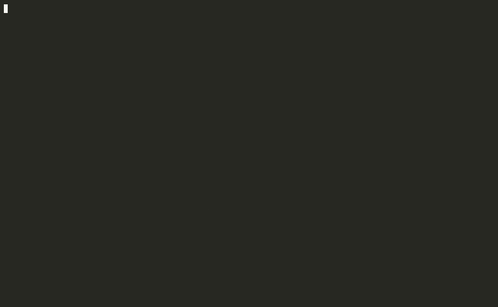
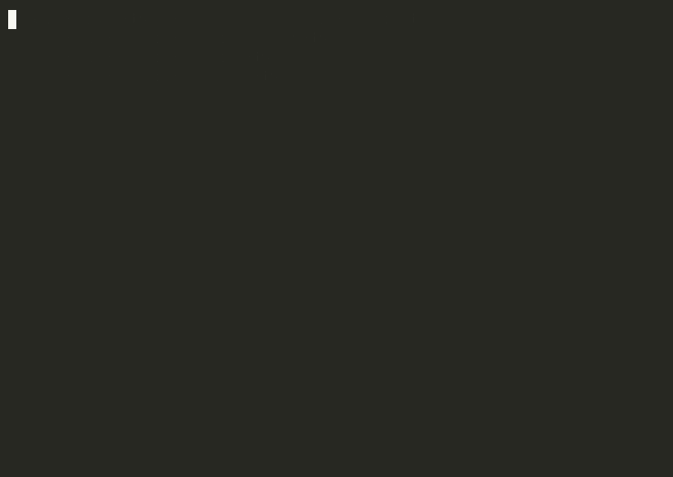

<p align="center">
  
</p>

# knixl

[](https://github.com/1stvamp/knixl/actions/workflows/ci.yml)
[](https://crates.io/crates/knixl)
[](https://github.com/1stvamp/knixl#licence)

knixl generates maintainable, human-readable Nix from small amounts of opinionated KDL.

- **Checked**: a typo, or an option that doesn't exist in your nixpkgs, refuses to generate.
- **Locked**: the same KDL always gives the same bytes, and upgrades wait for you to review them.
- **Pinned**: `knixl install curl@8.4.0` pins one package to one version on one host.

**Documentation: [knixl.dev/guide](https://knixl.dev/guide/introduction/)**, starting with [your first host](https://knixl.dev/guide/first-host/).

Pronounced "nix-ull". You describe each machine in a few lines of KDL; knixl writes ordinary NixOS modules from it, checks them against the real NixOS options, and records a hash of everything in a lockfile, so the same KDL always gives the same Nix and a knixl upgrade can't change your output without showing you first.

<p align="center">
  
</p>

## What it does

You write a few lines of KDL:

```kdl
host "web" {
    system "x86_64-linux"
    web-service "example.com" {
        upstream "http://127.0.0.1:3000"
        acme email="ops@example.com"
        hardened #true
    }
}
```

knixl expands it into a full NixOS module (nginx enabled, TLS and proxy recommendations on, ACME wired up, security headers added), formats it with nixfmt, writes it to `generated/`, and records hashes in a lockfile so the output is reproducible byte for byte.

The whole loop is compile, check, and read back the typed reference for any node:

<p align="center">
  
</p>

## Install

### Nix (flake)

```sh
nix run github:1stvamp/knixl -- --help      # run without installing
nix profile install github:1stvamp/knixl    # install into your profile
```

Or add `overlays.default` and put `pkgs.knixl` in your `environment.systemPackages` (NixOS) or `home.packages` (home-manager).

### crates.io

```sh
cargo install knixl
```

### Prebuilt binary

Download a tarball for your platform from the [latest release](https://github.com/1stvamp/knixl/releases/latest), or run the installer:

```sh
curl --proto '=https' --tlsv1.2 -LsSf https://github.com/1stvamp/knixl/releases/latest/download/knixl-installer.sh | sh
```

Built for Linux (gnu and musl) and macOS, on x86_64 and aarch64.

### From source

```sh
git clone https://github.com/1stvamp/knixl && cd knixl
cargo build --release        # or: mise run build
```

The binary lands at `target/release/knixl`.

### What it needs at runtime

A Nix formatter (`nixfmt` or `nixfmt-rfc-style`) on your `PATH`, and Nix for `knixl install` and for building the option set that validation checks against. `generate` and `check` work offline. Option validation checks against the NixOS option set for each host's nixpkgs, which `knixl upgrade` builds: see [Validation and the oracle](https://knixl.dev/guide/validation/).

## Quickstart

A knixl project is a directory with a `hosts/` folder in it, one `.kdl` file per machine.

```sh
mkdir -p demo/hosts && cd demo
cat > hosts/web.kdl <<'EOF'
host "web" {
    system "x86_64-linux"
}
EOF

knixl plan        # missing generated/hosts/web.nix
knixl generate    # writes generated/hosts/web.nix and knixl.lock.kdl
knixl check       # clean
```

From there, add modules to the host and regenerate. [Your first host](https://knixl.dev/guide/first-host/) walks through it, and on to a bootable system.

## What comes with it

Modules for the common ground are built in, so there's nothing to install or copy before you use them:

- **os**: boot loader, kernel, time zone, locale, sysctls, nix settings, system packages, tmpfiles rules.
- **user**, **openssh**, **firewall**, **tailscale**: users with SSH keys, a hardened SSH server, open ports and trusted interfaces, and Tailscale with its auth key from a secret.
- **disko**, **zfs**: declarative disk layouts (GPT, LUKS, swap, ZFS pools) and ZFS support.
- **web-service**, **security-headers**, **postgres**, **backups**: an nginx reverse proxy with TLS, shared security headers, PostgreSQL, and restic backups.
- **incus**, **guest**: an Incus host, and NixOS containers configured with knixl modules.
- **home-manager**, **nix-ld**, **package**: home-manager for a user, running prebuilt binaries, and packages (with version pins, or from another flake input).
- **raw-nix** and **import**: for the Nix no module covers.

`knixl doc <node>` prints what any of them accepts. [Using modules](https://knixl.dev/guide/modules/) has an example of each, and you can [write your own](https://knixl.dev/guide/writing-modules/) as a short KDL file.

knixl can also write the `flake.nix` that builds your machines (so `nixos-rebuild switch --flake` works straight away), installer ISOs, and NixOS images for Incus. See [From KDL to a running machine](https://knixl.dev/guide/running-machine/).

## Commands

- `knixl plan`: show what would change. Writes nothing.
- `knixl generate`: write the generated Nix and the lockfile.
- `knixl check`: for CI. Fails unless every generated file is up to date and unedited.
- `knixl upgrade`: review and apply version changes (a new knixl, a nixpkgs release, flake inputs).
- `knixl doc <node>`: what a module accepts.
- `knixl install <pkg>`: add a package to a host, check it with Nix, and regenerate. `pkg@version` pins a version.
- `knixl tui`: the interactive interface (shown above): add packages with a live preview, browse modules, and build your own.

If someone edits a generated file by hand, knixl notices and refuses to overwrite their change:

<p align="center">
  
</p>

[Day to day](https://knixl.dev/guide/day-to-day/) covers the everyday loop and what to do when `check` fails.

## Examples

`examples/hosts/` holds worked hosts, with the Nix knixl generates for each under `examples/expected/`. They're also on the site, side by side: [knixl.dev/examples](https://knixl.dev/examples/web/).

## Status

Released and in use; the [changelog](CHANGELOG.md) lists what each version added. New work is tracked in GitHub issues. The design specs and decision records, for contributors, are under `docs/` and at [knixl.dev/design](https://knixl.dev/design/architecture/).

## Licence

Licensed under either of Apache License, Version 2.0 (LICENSE-APACHE) or the MIT licence
(LICENSE-MIT) at your option. Unless you state otherwise, any contribution you submit for
inclusion is dual licensed as above, with no additional terms.
