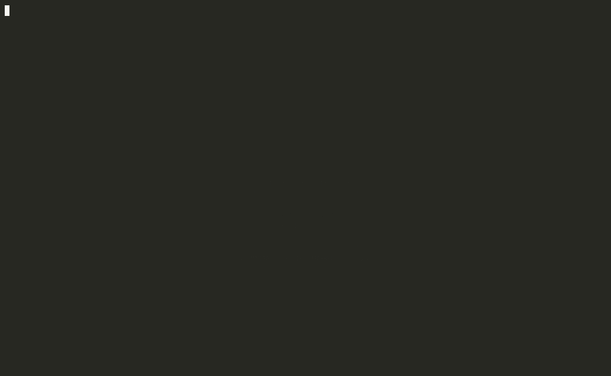

# The TUI

`knixl tui` opens an interactive terminal interface for the jobs that are easier with something to look at: adding a package while watching the Nix it produces, finding out what a module accepts, and building a module of your own. Everything it does can also be done by editing KDL and running commands; the TUI just shows you the result as you go.

Run it from inside a project. It needs a real terminal and refuses to start when its output is piped. The layout follows the size of your terminal.

## Getting around

The home screen offers **Install a package**, **Browse modules**, **New module** and **Quit**. Use the arrow keys to choose and `Enter` to open one.

On every screen:

- `Tab` and `Shift-Tab` (or the down and up arrows) move between controls. The focused one is highlighted. In a text area, such as the New module emit editor, the arrows move the cursor and only `Tab` and `Shift-Tab` leave it.
- `Enter` acts on the focused control: applies, toggles, opens.
- `Esc` goes back. On the home screen `q`, `Esc` or `Ctrl-C` quits.

Each screen shows its keys in a footer at the bottom.

Every action that changes something ends the session: applying an install, inserting a module and creating or saving a module all write their file, quit the TUI and print what they did. Cancelling writes nothing.

## Install a package

`knixl install` opens this screen when you run it in a terminal (pass `--yes` for the plain prompt instead), with the package and any version and flags you gave it. Opened from the home screen, it starts on your default host but can't pin a version or run the `--build` check: type `curl@8.4.0` and it tells you to run `knixl install curl@8.4.0` instead. The screen has:

- **Host**: which host gets the package. Left and right arrows switch between hosts.
- **Package**: the package to add, e.g. `ripgrep`. Type it and press `Enter` to check it.
- **Strict**: when on, a missing Nix is an error instead of a skipped check. `Space` or `Enter` toggles it.
- **Preview**: the generated `.nix` for the host with the package added. `PageUp` and `PageDown` scroll it.
- **Apply** and **Cancel**.

After you press `Enter` on a package, knixl checks it in the background (a spinner shows it working): it generates the host with the package added, validates the result, and asks Nix whether the package exists. A version pin also resolves the version to a nixpkgs commit and works out how to build it (see [Packages and pins](08-packages.md)), and each step gets a status row. Apply only becomes available once the checks pass. Applying writes the `package` line into the host's KDL (keeping your formatting and comments) and regenerates. Cancel (or `Esc`) leaves everything as it was.

## Browse modules

Browse lists every module available in the project, built in or your own, with the selected module's reference beside it: its arguments, properties and children, the same text `knixl doc` prints. The arrow keys move through the list, `PageUp`/`PageDown` scroll the reference, and `q` or `Esc` goes back.

- `Enter` (or `i`) inserts the module into a host: pick the host, and knixl adds a skeleton block for the module to that host's KDL file, then exits and tells you which file to finish editing. If the host already has that module, it says so and changes nothing.
- `e` opens the module in the editor described below, for modules defined in a `knixl-module.kdl` file in your project. The modules built into knixl can't be edited here.

## Check for updates

This screen runs the [update report](05-day-to-day.md#being-told-about-updates) in the background (a spinner shows it working; it takes a few minutes) and then shows, for each host that would move, how many packages change and how many CVEs the update fixes, with the full report underneath (`PageUp`/`PageDown` scroll it). Below the summary are your choices:

- **take the whole nixpkgs update**, and under it **only if it fixes CVEs**, which applies the update only when it does.
- **pin <package> to <version> on <host>**, one for each package a host installs directly that the update would change. These are an alternative to the whole update, so they're greyed out when it's chosen.

`Space` or `Enter` toggles a choice, and **Apply** carries them out with the same commands you'd run yourself (`knixl upgrade --refresh --yes`, then `knixl generate`, or `knixl install <package>@<version>` for each pin) and ends the session. The screen needs a generated flake; without one it says so.

## New module

This screen builds a declarative module, the kind described in [Writing your own modules](10-writing-modules.md), without writing its file by hand. You fill in:

- **Name**, **Node** (the KDL node name the module claims) and **Summary**.
- **Schema entries**: one row per argument, property or child, each with a name, a type (string, int or bool) and whether it's required or repeated. A child can have its own sub-fields. Left and right arrows (or `Space`) cycle a row's kind and type. `Enter` on a row's add control adds a sub-field, and `Backspace` there removes the last one; `Enter` on delete removes the row.
- **Emit**: the template that turns the node into NixOS options, typed as text. [Writing your own modules](10-writing-modules.md#the-emit-block-what-it-sets) explains the statements it takes.

Validation runs as you type: the status line says whether the schema and template are consistent (a template that refers to a field the schema doesn't declare, for example, is flagged straight away). **Create** is only available when it is. Creating writes `modules/<name>/knixl-module.kdl` in the project (it refuses if that module already exists), and the module is usable on the next `generate`.

When you open an existing module with `e` from Browse, the same screen loads it, and saving overwrites its file.
